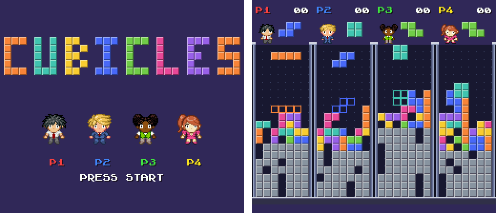

# Cubicles

A falling-block versus game for the Super Nintendo, for 1 to 4 players around a WorkAdventure arcade cabinet.
See [DESIGN.md](DESIGN.md).



## Play

In your browser: https://workadventure-maps.github.io/cubicle/ (built from `main` by GitHub Actions).

- Press **Start** to join. Alone, it's an endless score attack; a second player's Start turns it into a versus
  match. Players 2 to 4 need a Multitap in port 2 (snes9x: set port 2 to "Multitap").
- **Left / Right** move, **Down** drops faster, **Up**, **A** or **X** turns the piece, **B** or **Y** drops it at
  once. On the cabinet's keyboard: arrows, **Z** turns, **X** drops.
- Clearing 2 or more lines at once sends junk rows to every opponent. Last well standing wins the match; the
  pieces fall faster every 30 seconds. A player who doesn't touch the pad during a whole match (someone who left
  the cabinet) sits out the next one until they press Start again.
- Alone, you get music: "In the Hall of the Mountain King" gets more tense as your stack rises and faster as
  your level goes up. Versus matches have no music, so the players can hear each other.

## Build

Linux, Python 3 with Pillow and NumPy, make, curl, unzip.

```bash
tools/setup.sh   # downloads PVSnesLib 4.6.0 and the snes9x libretro core into .tools/
make             # builds cubicles.sfc
make test        # headless gameplay and budget tests on the snes9x core
```

## Play locally

In a browser (needs WebGL and internet for EmulatorJS; 2 players on the keyboard, gamepads for 3-4):

```bash
make site
python3 -m http.server 8000 -d _site   # then open http://localhost:8000
```

In a desktop emulator: open `cubicles.sfc` in snes9x (`flatpak install flathub com.snes9x.Snes9x`) and set
controller port 2 to "Multitap" for players 3 and 4.

## Layout

| Path | What |
|---|---|
| `src/main.c` | game: matches, wells, pieces, HUD, VBlank transfers |
| `src/well.asm` | hot paths in 65816 assembly: collisions, landing row, piece drawing, collapsing rows, junk |
| `src/music.asm` | boots our sound driver; sets the music tempo and the next pattern from the game |
| `snesmod/sm_spc.asm` | the SNESMOD sound driver from PVSnesLib, altered: tempo and next-pattern commands |
| `music/mountain_king.it` | the music, an Impulse Tracker module: open it in a tracker (Schism Tracker, OpenMPT) |
| `data.asm` | graphics and sound data included in the ROM |
| `tools/mkgfx.py` | builds the blocks, partitions, font and Woka sprites |
| `tools/mksfx.py` | synthesizes the placeholder sound effects |
| `tools/mkmod.py` | arranged `assets/mountain_king.mid` (the score) into the .it module, instruments included |
| `tools/snes.py` | small headless libretro frontend: scripted input, Multitap, screenshots, RAM/VRAM reads |
| `tests/smoke.py` | gameplay tests, including VBlank and frame-time budgets |
| `web/index.html` | browser player page: the ROM in [EmulatorJS](https://emulatorjs.org), Multitap on port 2 (`make site`) |
| `.github/workflows/build.yml` | builds and tests every push; publishes the page and the ROM from `main` |

## Credits

- Characters: Woka parts designed by the WorkAdventure team (`assets/woka/`), redrawn at 21x21 for the game
  (`assets/sprites/`, from Bombadventure), © WorkAdventu.re, MIT.
- Font: PVSnesLib example font by Alekmaul, zlib license, see `assets/font.LICENSE.txt`.
- Music: "In the Hall of the Mountain King" by Edvard Grieg (1875), notes from the public-domain score typeset by
  Coyau for the [Mutopia Project](https://www.mutopiaproject.org/cgibin/piece-info.cgi?id=1888) (#1888);
  arrangement and synthesized instruments MIT.
- Sound driver: SNESMOD by Mukunda Johnson, WLA DX port by KungFuFurby and the PVSnesLib team, zlib license
  (notice in `snesmod/sm_spc.asm`, which we altered).
- Built with [PVSnesLib](https://github.com/alekmaul/pvsneslib). The web page loads EmulatorJS (GPL-3.0) from its CDN.

## License

MIT, see [LICENSE](LICENSE).
